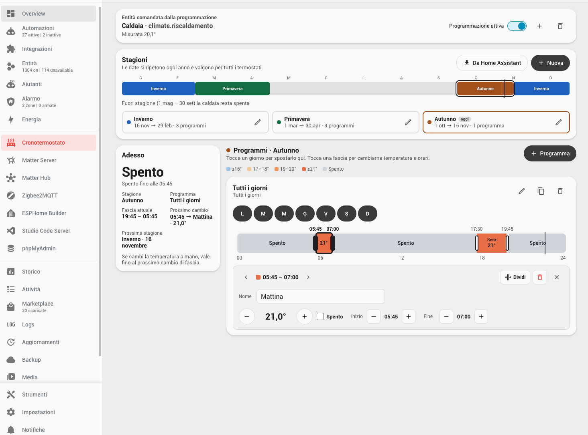
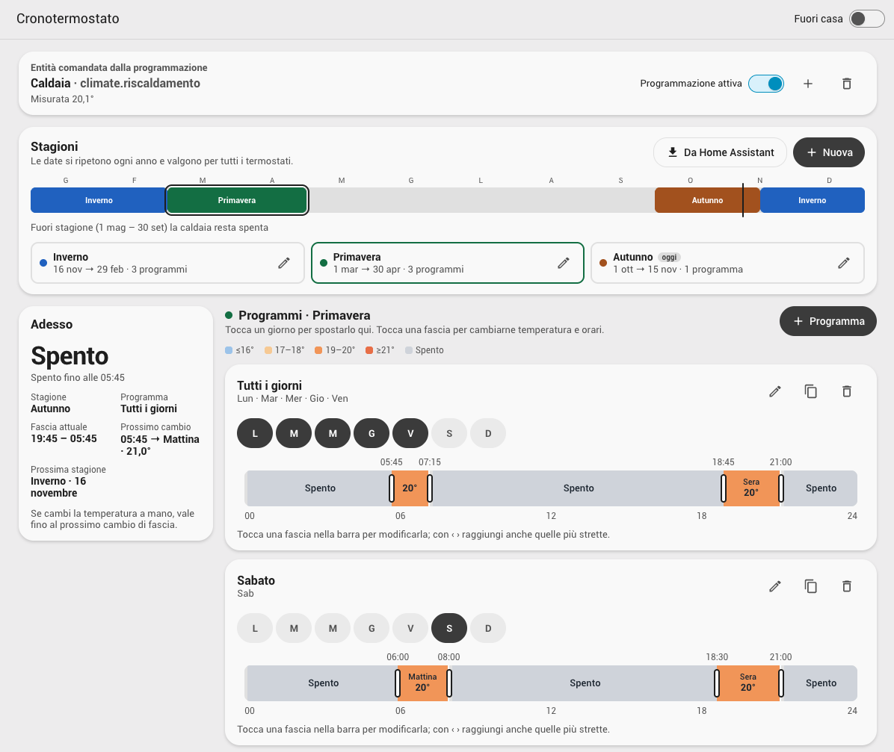
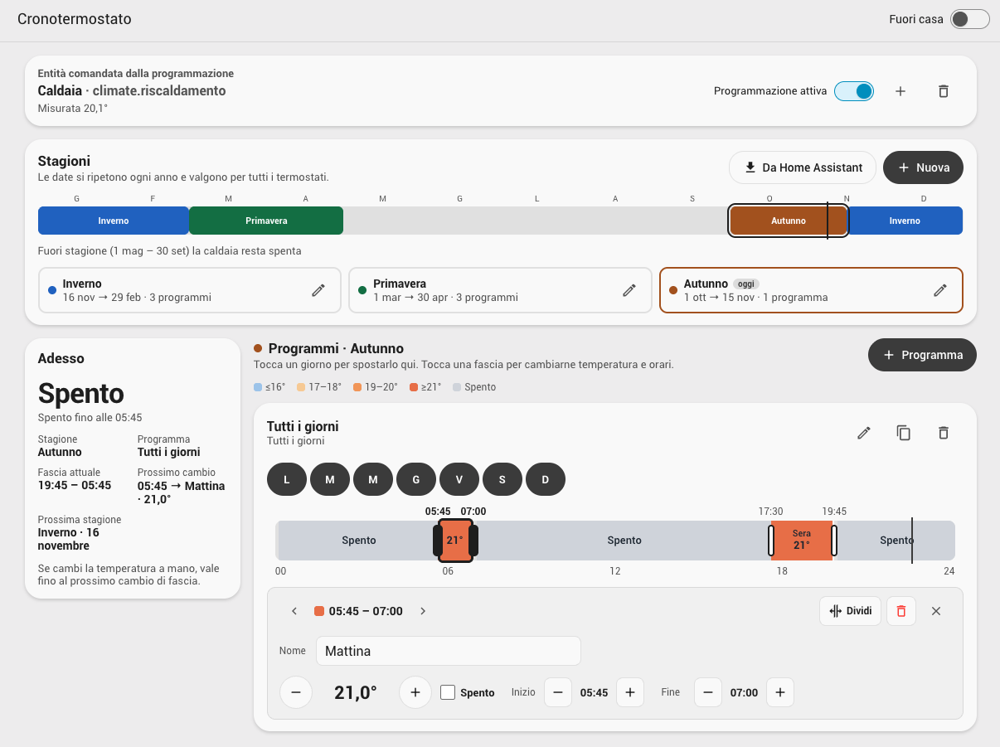
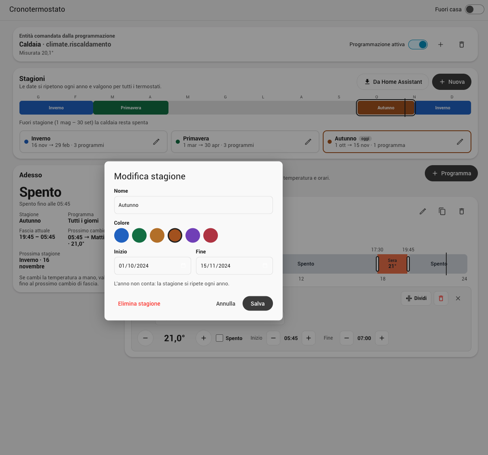

# Cronotermostato stagionale

Programmazione del riscaldamento per **stagioni** in Home Assistant, pensata per una caldaia comandata da un'entità `climate` (per esempio un `generic_thermostat`).

Fork di [talhaucar/smart-heating-schedule](https://github.com/talhaucar/smart-heating-schedule) (MIT), da cui riprende il motore che invia i comandi, la gestione delle modifiche manuali e dei riavvii.



| Programmi di una stagione | Modifica di una fascia | Modifica di una stagione |
| --- | --- | --- |
|  |  |  |

## Cosa fa

Il pannello nella barra laterale permette di:

- **dividere l'anno in stagioni** con data di inizio e fine scelte da calendario. Le date si ripetono ogni anno e possono attraversare il capodanno (es. 15 ottobre → 15 aprile). Di partenza ci sono le stagioni meteorologiche di Home Assistant: inverno, primavera, estate e autunno.
- dare a ogni stagione dei **programmi**. Un programma vale per **uno o più giorni** della settimana, scelti con i pulsanti L M M G V S D, e ogni giorno appartiene a un solo programma.
- modificare le **fasce orarie** direttamente sulla barra delle 24 ore: tocchi una fascia per selezionarla, trascini i separatori per cambiare gli orari (a passi di 15 minuti), cambi la temperatura con − e +, oppure **Dividi** ed **Elimina** la fascia. A ogni fascia puoi dare un **nome** facoltativo (es. *Risveglio*, *Notte*), che compare sulla barra e nel sensore.
- tenere la caldaia **spenta fuori stagione** e nei giorni senza programma. Di default l'estate non ha programmi.
- attivare **Fuori casa**: il termostato passa al suo preset *Fuori casa* (`away`). Se non ha quel preset, usa una temperatura fissa configurabile, 15 °C di default. Fuori casa è sincronizzato col termostato: se scegli *Fuori casa* dalla card di Home Assistant si attiva anche qui, e se lo lasci (per esempio con *Comfort*) si disattiva. La tua scelta resta valida fino alla fascia successiva.

## Come comanda il termostato

| Situazione | Comando |
| --- | --- |
| Fascia a 20 °C | `hvac_mode: heat`, `preset_mode: none`, `temperature: 20` |
| Fascia *Spento*, fuori stagione, giorno senza programma | `hvac_mode: off` |
| Fuori casa attivo | `hvac_mode: heat`, `preset_mode: away` (o la temperatura fuori casa) |

Prima di impostare una temperatura, un preset attivo (comfort, sonno…) viene riportato a `none`, così `generic_thermostat` segue davvero il programma.

I comandi vengono inviati **solo quando cambia qualcosa**: un cambio di fascia, una nuova stagione, Fuori casa o una modifica. Se cambi la temperatura a mano, vale fino alla fascia successiva. Nel pannello compare **Torna al programma** per annullare subito la modifica manuale.

## Installazione

Richiede Home Assistant 2026.3 o successivo.

1. In **Marketplace** → **Aggiungi da collegamento**.
2. Aggiungi `https://github.com/albertolivetti/smart-heating-schedule` di tipo **Integrazione**.
3. Installa **Cronotermostato stagionale** e riavvia Home Assistant.
4. Vai in **Impostazioni → Dispositivi e servizi → Aggiungi integrazione** e scegli **Cronotermostato stagionale**.
5. Apri **Cronotermostato** nella barra laterale e scegli l'entità `climate` della caldaia.

### Aggiornamenti

Le nuove versioni escono come **release** su GitHub (`v0.2.0`, `v0.2.1`, …) con le note in italiano. Il Marketplace le propone come aggiornamento in **Impostazioni** e nel Marketplace; dopo l'aggiornamento serve un **riavvio** di Home Assistant.

## Colori delle fasce

| Colore | Temperatura |
| --- | --- |
| Azzurro | fino a 16° |
| Arancio chiaro | 17–18° |
| Arancio | 19–20° |
| Arancio scuro | 21° e oltre |
| Grigio | Spento |

I temi possono cambiarli con le variabili CSS `--shs-color-cold`, `--shs-color-cool`, `--shs-color-warm`, `--shs-color-hot` e `--shs-color-off`.

## Entità

| Entità | Descrizione |
| --- | --- |
| `switch.cronotermostato_away` | Fuori casa |
| `sensor.cronotermostato_active_season` | Stagione di oggi (sconosciuta fuori stagione) |
| `switch.<termostato>_schedule` | Attiva o disattiva la programmazione |
| `sensor.<termostato>_scheduled_temperature` | Temperatura richiesta ora. Attributi: `season`, `program`, `away`, `block_name`, `block_start`, `block_end`, `next_temperature`, `next_block_name`, `heating_off`, `overridden`, `pending`, `last_error` |

## Azioni

```yaml
# Torna alla fascia in corso, annullando le modifiche manuali
action: smart_heating_schedule.resume_schedule
target:
  entity_id: climate.riscaldamento

# Legge stagioni e programmi
action: smart_heating_schedule.get_schedule
data:
  entity_id: climate.riscaldamento
response_variable: programmazione

# Sostituisce i programmi di una o più stagioni (per id di stagione)
action: smart_heating_schedule.set_schedule
data:
  entity_id: climate.riscaldamento
  programs:
    winter:
      - id: feriali
        name: Feriali
        days: [mon, tue, wed, thu, fri]
        blocks:
          - { start: "00:00", temperature: 17 }
          - { start: "06:30", temperature: 20, name: Risveglio }
          - { start: "22:30", temperature: 17, name: Notte }
      - id: weekend
        name: Weekend
        days: [sat, sun]
        blocks:
          - { start: "00:00", temperature: 17 }
          - { start: "08:00", temperature: 21 }
```

Ogni giorno di programma inizia con una fascia alle `00:00`. Gli orari sono su una griglia di 15 minuti, `temperature: null` significa spento e `name` (facoltativo, fino a 30 caratteri) dà un nome alla fascia.

## Automazioni sulle fasce

All'inizio di ogni fascia viene lanciato l'evento `smart_heating_schedule_block_started`, con `entity_id`, `season`, `program`, `block_name`, `temperature`, `heating_off`, `away`, `block_start`, `block_end`, `next_temperature` e `next_block_name`. Fasce vicine con la stessa temperatura e lo stesso nome contano come una sola.

```yaml
# Accende il deumidificatore quando inizia la fascia "Risveglio"
triggers:
  - trigger: event
    event_type: smart_heating_schedule_block_started
    event_data:
      entity_id: climate.riscaldamento
      block_name: Risveglio
actions:
  - action: switch.turn_on
    target:
      entity_id: switch.deumidificatore
```

L'evento parte solo ai cambi di fascia, non quando modifichi il programma o riavvii Home Assistant. Per sapere in ogni momento la fascia in corso usa l'attributo `block_name` del sensore.

## Opzioni

In **Impostazioni → Dispositivi e servizi → Cronotermostato stagionale → Configura**:

- **Temperatura fuori casa**, per i termostati senza preset `away`;
- **Mostra il pannello solo agli amministratori**.

## Dati

Stagioni e programmi sono salvati in `.storage/smart_heating_schedule` e finiscono nei backup di Home Assistant. Le programmazioni settimanali Casa/Fuori casa dell'integrazione originale vengono convertite automaticamente in programmi per ogni stagione, estate esclusa.

## Licenza

MIT, come il progetto originale.
